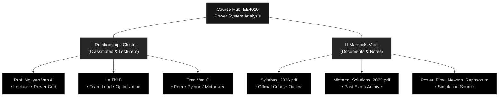
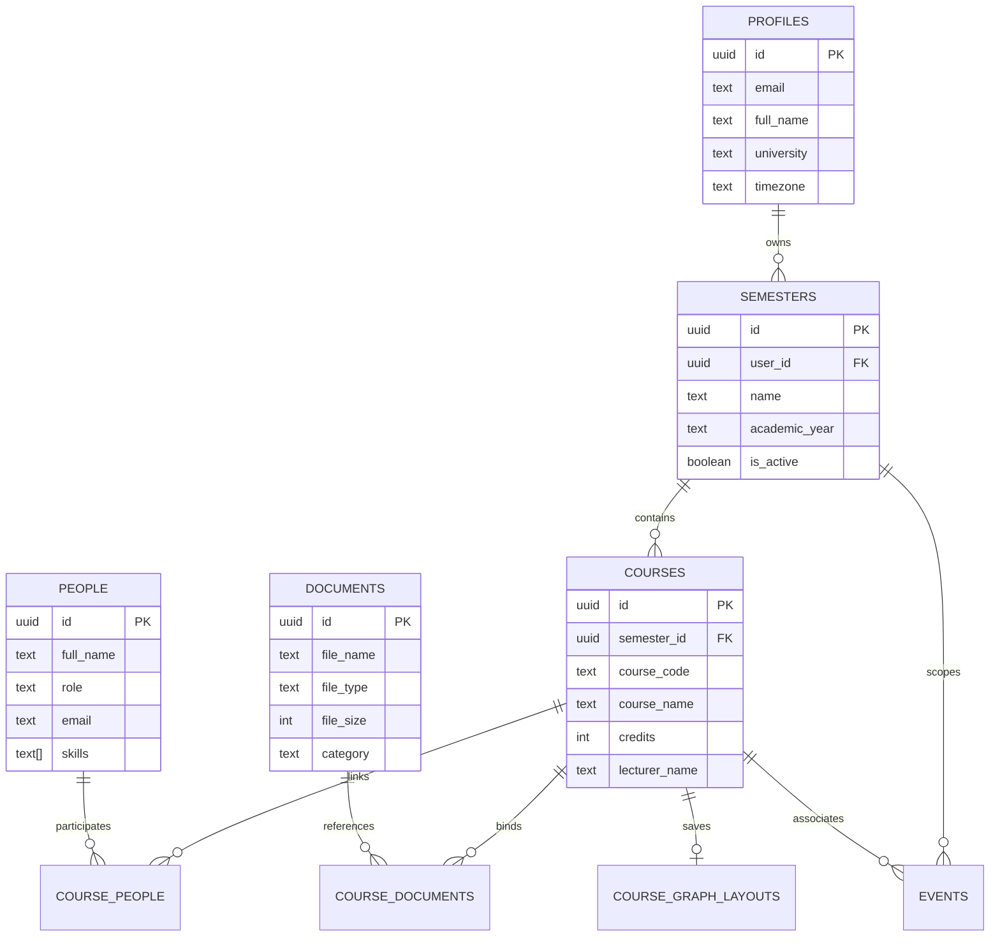

<div align="center">

```
 _   _ _____ _   _ ____   ___  _   _ 
| \ | | ____| | | |  _ \ / _ \| \ | |
|  \| |  _| | | | | |_) | | | |  \| |
| |\  | |___| |_| |  _ <| |_| | |\  |
|_| \_|_____|\___/|_| \_\\___/|_| \_|
```

### **Personal Academic Intelligence & Neural Knowledge Graph System**

*Connect People. Connect Knowledge. Designed with an uncompromising monochrome aesthetic.*

---

[](https://github.com/Laxury-H/NEURON/stargazers)
[](LICENSE)
[](https://nextjs.org/)
[](https://www.typescriptlang.org/)
[](https://reactflow.dev/)
[](https://supabase.com/)
[](tests/neuron.test.mjs)

<br />

[**Explore Documentation**](#-architecture--knowledge-topology) · [**Quickstart (60s)**](#-quickstart-in-60-seconds) · [**Feature Tour**](#-core-capabilities) · [**Database & Security**](#-database-schema--rls-security) · [**Report Issue**](https://github.com/Laxury-H/NEURON/issues)

</div>

---

## ✦ Why NEURON?

Traditional learning management systems (LMS) and generic note-taking tools treat university academics as disjointed folders, flat bookmark lists, and chaotic messaging threads. Syllabi get lost in downloads, lecture files sit unorganized, and classmate contacts disappear across fragmented chat apps.

**NEURON** reimagines university life as a **living, spatial knowledge network**. Every course is a neural hub connecting study materials, classmate networks, and academic deadlines into a single visual brain.

| Dimension | Traditional Academic Setup | The NEURON Architecture |
| :--- | :--- | :--- |
| **Knowledge Topology** | Nested folders & scattered PDFs | **Interactive 2D Neural Graphs** powered by `@xyflow/react` |
| **Academic Network** | Lost in Zalo, Telegram & Messenger | **People Graph** linked across multiple courses with skill & contact tags |
| **Time & Deadlines** | Separate calendar apps & lost dates | **Unified Semester Calendar** aggregating classes, exams & assignment milestones |
| **Storage Engine** | Locked into proprietary cloud silos | **Dual Engine**: Instant Local Persistence ⇄ Supabase Cloud Sync |
| **Design Language** | Distracting colorful badges & clutter | **Strict Achromatic Monochrome** built on Swiss typography & zero-hue contrast |
| **Search & Discovery** | Manual clicking through hierarchies | **Universal Spotlight Search** (`Cmd+K` / `Ctrl+K`) across all entities |

---

## 🧠 Architecture & Knowledge Topology

NEURON organizes university experience into a clean hierarchical mental model:

```
ACADEMIC TIMELINE (Workspace)
 └── SEMESTERS (e.g. Fall 2026, Spring 2027)
      ├── UNIFIED SEMESTER CALENDAR (FullCalendar v6: Lectures, Exams, Milestones)
      └── COURSES (e.g. EE4010 - Power Systems, CS3100 - Algorithms)
           └── COURSE NEURAL GRAPH
                │
                ├── [CENTRAL HUB] Course Node (Code, Title, Credits, Syllabus)
                │
                ├── [RELATIONSHIP CLUSTER] People & Network
                │    ├── Lecturers & Teaching Assistants (Office hours, email, contacts)
                │    ├── Project Teammates (Domain expertise, skills, notes)
                │    └── Study Group Peers (Linked across multiple courses)
                │
                └── [MATERIAL CLUSTER] Academic Vault
                     ├── Syllabus & Lecture Slides
                     ├── Past Exams & Solutions
                     └── Assignments & Project Files (with in-app modal preview)
```

### Neural Radial Layout & Interactive Flow



---

## ⚡ Core Capabilities

### 1. Spatial Course Neural Graph (`@xyflow/react`)
- **Three-Tier Expansion**: Starts with a clean triad (Course Node, Relationships Group, Documents Group). Expand or collapse clusters on demand.
- **Radial Auto-Layout**: Smooth mathematical distribution of surrounding nodes around the parent hub without node overlapping.
- **Persistent Spatial State**: Drag positions, zoom scale, and canvas viewport coordinates are automatically debounced and saved (`course_graph_layouts`). Restored seamlessly when returning to the course.
- **Node Context Inspectors**: Clicking any entity slides out a dedicated monochrome inspector panel for editing contacts, viewing file annotations, or adjusting course-specific context notes.

### 2. Multi-Course Academic Network
- **Global Person Library**: Register professors, lab instructors, and fellow students once; link them to multiple courses with course-specific context notes (e.g. *"Lab Partner for Project 1"* vs *"Lead TA for Midterm grading"*).
- **Competency & Topic Tags**: Tag contacts with academic skills (e.g., `MATLAB`, `Latex`, `Verilog`, `Calculus III`) for instant study-group search.
- **Direct Communication Links**: Quick access to Telegram, GitHub, Email, Phone, and university IDs.

### 3. Unified Document Vault & In-App Preview
- **Categorized Academic Materials**: Tag documents as `SYLLABUS`, `LECTURE`, `EXAM`, `ASSIGNMENT`, or `OTHER`.
- **In-App Document Previewer**: Inspect lecture outlines, code snippets, and PDFs without navigating away from the knowledge canvas.
- **Non-Destructive Course Unlinking**: Detach a textbook or reference sheet from an individual course without wiping it from your global library.

### 4. Unified Semester Calendar (`FullCalendar v6`)
- **Multi-Course Aggregation**: Consolidates schedules from all courses in the active semester into one master schedule.
- **Recurring Class Schedules**: Native weekly recurrence engine for semester-long lecture timetables.
- **Category Filter Chips**: Filter view by `CLASS`, `EXAM`, `DEADLINE`, or `PERSONAL` using monochrome hatched and bordered chips.
- **Multiple Visualizations**: Seamlessly toggle between Month Grid, Time Grid (Week/Day), and Agenda List views.

### 5. Universal Spotlight Search (`Cmd+K` / `Ctrl+K`)
- Instant keyboard-driven global search indexing Semesters, Courses, People, Documents, and Calendar Milestones.
- Typeahead navigation directly zooms into course graphs or opens calendar dates.

### 6. Zero-Config Dual Storage Engine
- **Local-First Ready**: Works out-of-the-box with browser `localStorage`. Pre-seeded with a comprehensive sample university semester (`Fall 2026`).
- **Cloud-Native Scalability**: Supply Supabase credentials to automatically upgrade to cloud storage with PostgreSQL and Row-Level Security (RLS).
- **JSON Vault Backup**: One-click full workspace export, schema-validated import, and instant restore.

---

## 🎨 The Strict Achromatic Palette System

NEURON rejects colorful distraction to ensure complete cognitive clarity. The design system is 100% achromatic, adhering to Swiss typographic standards:

```
┌────────────────────────────────────────────────────────────────────────┐
│                        STRICT MONOCHROME SCALE                         │
├───────────┬───────────┬───────────┬───────────┬───────────┬────────────┤
│  #FFFFFF  │  #FAFAFA  │  #F5F5F5  │  #E5E5E5  │  #D4D4D4  │  #A3A3A3   │
│  Canvas   │  Surface  │  Card BG  │  Subtle   │  Border   │  Muted Txt │
├───────────┼───────────┼───────────┼───────────┼───────────┼────────────┤
│  #737373  │  #525252  │  #404040  │  #262626  │  #171717  │  #000000   │
│  Dimmed   │  Inactive │  Border-D │  Dark El  │  Neutral  │  Obsidian  │
└───────────┴───────────┴───────────┴───────────┴───────────┴────────────┘
```

- **Zero Accents**: No blue links, no green checkmarks, no purple buttons.
- **Hierarchy Through Texture**: Contrast is established through typography weight (`font-light` to `font-black`), border thicknesses, dot-grid canvas backgrounds, and inverted fills.
- **First-Class Dark & Light Modes**: Pure obsidian dark mode and crisp gallery light mode.

---

## 🚀 Quickstart in 60 Seconds

### Prerequisites
- [Node.js](https://nodejs.org/) v18.0.0 or later (tested on v20.x and v25.x)
- [`pnpm`](https://pnpm.io/) v8+ (or `npm` / `yarn` / `bun`)

### 1. Clone & Install

```bash
git clone https://github.com/Laxury-H/NEURON.git
cd NEURON
pnpm install
```

### 2. Configure Environment (Optional)

```bash
cp .env.example .env.local
```

> **Note**: If you don't configure Supabase, NEURON runs in **Persistent Local Mode** with pre-seeded demo data. No database setup is required to run the app immediately!

### 3. Start Development Server

```bash
pnpm dev
```

Navigate to [**http://localhost:3000**](http://localhost:3000) to open your academic workspace.

---

## 🧪 Testing & Verification Suite

NEURON includes an automated verification suite covering data integrity, graph logic, and design constraints:

```bash
pnpm test
```

```text
✔ 1. Semester Management — Real DataRepository CRUD & Ordering (2.5ms)
✔ 2. Course Management — CRUD and Semester Scoping (0.8ms)
✔ 3. Course Neural Graph — Three Primary Nodes Structure & Data Loader (0.4ms)
✔ 4. Relationships — Multi-Course Linking, Context Notes & Contact Links (0.4ms)
✔ 5. Documents — Upload, Course Linking, and Global Library Preservation (0.4ms)
✔ 6. Graph Layout Persistence — Position & Viewport Restoration (0.7ms)
✔ 7. Semester Calendar — Unified Aggregation across Categories (0.3ms)
✔ 8. Calendar Course-Semester Integrity Rule Enforcement (0.2ms)
✔ 9. Calendar Weekly Recurrence Rule Parsing and Integrity (0.2ms)
✔ 10. Universal Global Search — Full Indexing across All Domains (12.7ms)
✔ 11. Data Backup Export, Recovery & Schema Validation (0.6ms)
✔ 12. Database Migration SQL & RLS Security Rules Verification (0.5ms)
✔ 13. Strict Monochrome Palette Compliance (0.5ms)

ℹ tests 13 | suites 0 | pass 13 | fail 0 | cancelled 0
```

To run a production build verification:

```bash
pnpm build
```

---

## 🗄️ Database Schema & RLS Security

When connecting Supabase Cloud, run the migration script at [`supabase/migrations/20261103000001_initial_schema.sql`](supabase/migrations/20261103000001_initial_schema.sql).

### Entity Relationship Diagram



### Security & Row Level Security (RLS)
- Every table has **RLS enabled** by default.
- Every read, insert, update, and delete query is strictly bound to `auth.uid() = user_id`.
- Supabase Storage bucket `academic-documents` is secured with path-based owner policies (`(storage.foldername(name))[1] = auth.uid()::text`).

---

## 📂 Project Organization

```text
NEURON/
├── src/
│   ├── app/                               # Next.js 15 App Router
│   │   ├── app/                           # Protected Academic Workspace
│   │   │   ├── calendar/                  # Unified Semester Calendar View
│   │   │   ├── semesters/                 # Semester & Course Hierarchy
│   │   │   │   └── [semesterId]/
│   │   │   │       └── courses/[courseId]/# Course Neural Graph Canvas
│   │   │   └── settings/                  # User Profile, Backup & Restore
│   │   ├── globals.css                    # Monochrome CSS Design Tokens
│   │   └── layout.tsx                     # Root App Layout & Theme Provider
│   ├── components/
│   │   ├── calendar/                      # FullCalendar Event Panels & Recurrence
│   │   ├── graph/                         # @xyflow/react Canvas, Nodes & Inspectors
│   │   ├── navigation/                    # Monospaced Sidebar & Global Search
│   │   └── ui/                            # Monochrome Primitive Components
│   └── lib/
│       ├── data/                          # Dual-Engine Repository (Local + Supabase)
│       ├── types/                         # Strict TypeScript Entity Definitions
│       └── supabase/                      # Cloud Client & Middleware Handlers
├── supabase/
│   ├── migrations/                        # PostgreSQL DDL & RLS Policies
│   └── seed.sql                           # Academic Workspace Seed Fixture
├── tests/
│   └── neuron.test.mjs                    # End-to-End Automated Validation Suite
├── package.json
└── tsconfig.json
```

---

## 🛠️ Tech Stack & Ecosystem

| Layer | Technology | Key Highlights |
| :--- | :--- | :--- |
| **Framework** | [Next.js 15 (App Router)](https://nextjs.org/) | Server Components, Turbopack, Streaming SSR |
| **Language** | [TypeScript 5.8](https://www.typescriptlang.org/) | 100% strict type definitions and schemas |
| **Graph Engine** | [@xyflow/react 12](https://reactflow.dev/) | Radial nodes, smooth bezier curves, pan & zoom |
| **Calendar Engine** | [FullCalendar v6](https://fullcalendar.io/) | DayGrid, TimeGrid, recurrence rule parser |
| **Styling** | [Tailwind CSS 3.4](https://tailwindcss.com/) | Bespoke achromatic color token system |
| **UI Primitives** | [Radix UI](https://www.radix-ui.com/) | Accessible dialogs, dropdowns, and sheet inspectors |
| **Backend / DB** | [Supabase](https://supabase.com/) | PostgreSQL 15, RLS policies, Storage buckets |
| **Icons** | [Lucide React](https://lucide.dev/) | Crisp, optical-grid iconography |

---

## 🤝 Contributing

Contributions to NEURON are welcome! Whether it is extending graph layout algorithms, adding export formats (BibTeX, Notion, Obsidian), or improving accessibility:

1. **Fork** the repository
2. **Create** your feature branch (`git checkout -b feat/amazing-feature`)
3. **Commit** your changes following conventional commits (`git commit -m 'feat: add obsidian export'`)
4. **Run** the test suite to ensure all 13 checks pass (`pnpm test`)
5. **Push** to the branch (`git push origin feat/amazing-feature`)
6. **Open** a Pull Request

---

## 📄 License

Distributed under the **MIT License**. See [`LICENSE`](LICENSE) for more information.

---

<div align="center">
  <sub>Built with mathematical precision for university academics. Designed by <a href="https://github.com/Laxury-H">Laxury-H</a>.</sub>
</div>
